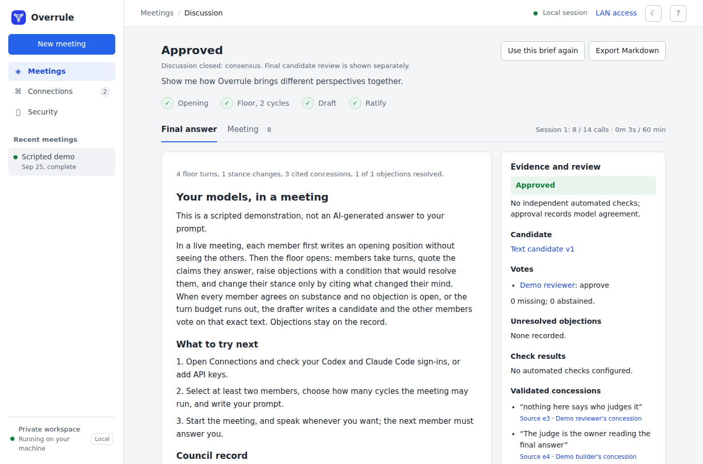

# Overrule

A local web app where several AI models hold a meeting about your problem and have to show their work. Each member opens with an independent position, then they argue on a shared floor: quoting the claim they answer, raising objections with a condition that would resolve them, and citing what changed their mind. A drafter writes the candidate, the others vote on that exact text, and the result carries the council record: how the floor closed, the vote, and every objection verbatim.

What makes it different from a group chat is the receipts. A meeting can be pointed at a project on your machine, at an access level whose boundary the app measures before offering it. The drafter implements in an isolated checkout, the app commits what it left behind, runs the checks you named on that exact commit, and shows voters the diff and the check output. Nothing touches your working tree until you press Apply.



[Watch a real meeting](https://binary-knight.com/assets/overrule-meeting.webm), sped up to 36 seconds: GPT-5.6 and two Claude models argue SQLite against Postgres for a side project, concede points, object, and vote on the final answer.

Runs on Node.js 22 or newer with no runtime dependencies. Models come from your own subscriptions and keys: the Codex and Claude Code CLIs signed in on the host, or API keys for OpenAI, Anthropic, Gemini, Grok, Hugging Face, and any OpenAI-compatible server such as Ollama, LM Studio, or vLLM.

## Install

```sh
git clone https://github.com/binary-knight/overrule.git
cd overrule
npm start
```

Open http://localhost:4310 and choose **Try a scripted demo** to see a meeting without spending any credits. Set `PORT` if the default is busy. `npm restart` (or `./restart.sh`) restarts a server running in the background and logs to `data/server.log`. The server binds to all interfaces so other devices on your LAN can pair with it; set `OVERRULE_HOST=127.0.0.1` to keep it to this machine.

Optional host tools: `pdftotext` (poppler-utils) to read PDFs attached to a meeting, LibreOffice for old `.doc` and `.xls` files, Python 3.10+ to install [agentsec-pack](https://github.com/binary-knight/agentsec-pack) from inside the app for sandbox measurement.

## Connect your models

The default council seats Codex and Claude Code. Install their official CLIs and sign in from your own terminal:

```sh
codex login
claude auth login
```

The app checks each CLI's sign-in status at start and on demand, never reads their token files, and refuses to start a meeting that would fail on a signed-out member. Add more members from **Connections**:

| Connection | Authentication | Protocol |
| --- | --- | --- |
| Codex | The CLI's own sign-in | `codex exec --json` |
| Claude Code | The CLI's own sign-in | `claude --print --output-format json` |
| OpenAI API | Saved key or `OPENAI_API_KEY` | Responses API |
| Anthropic API | Saved key or `ANTHROPIC_API_KEY` | Messages API |
| Gemini API | Saved key or `GEMINI_API_KEY` | OpenAI compatibility endpoint |
| Grok API | Saved key or `XAI_API_KEY` | Chat Completions |
| Hugging Face Inference Providers | Saved token or `HF_TOKEN` | OpenAI-compatible, via the HF router |
| OpenAI-compatible | Optional saved key | Any `/chat/completions` endpoint, with presets for local servers |

Every connection names one model, and you can hold several connections per provider, so one council can seat different models from the same vendor beside a local one. The model field suggests what the provider itself lists, fetched when you open the form or paste a key, newest first, with embedding, speech, image, and moderation models left out: each API's own model list, a local server's `/models`, Codex's catalog from its CLI, and Claude Code's aliases (`fable`, `opus`, `sonnet`, `haiku`) plus Anthropic's full list when an Anthropic key is available. Any ID can still be typed; one the provider did not list is saved with a warning. **Test connection** sends one short message through the same path a meeting uses, before anything is saved, and says whether the provider was reached, the key accepted, and the model answered. A provider that is down, slow, or never answers is given up on at a deadline and shown as unreachable, with what to check; the last list it gave stays on offer. Each member gets a perspective: pick one of ten archetypes or write your own. A meeting seats two to eight members. Unticking a connection for one meeting keeps it saved for the next. Save the seats you use together as a named **council**, with whichever of its drafter, meeting length, revisions, research, and limits you want kept, and seat it again in one step from the browser or with `--council` on the command line; a council can also be saved from a finished meeting. Saved keys are encrypted at rest and never sent back to the browser.

Subscription sign-ins are personal credentials. The app launches the unmodified CLIs on your machine and leaves authentication with the vendor. Do not turn it into a shared subscription proxy.

## How a meeting runs

1. **Brief.** Describe the problem, pick the members, choose how many cycles the floor runs (a cycle is one turn per member) and who drafts. Attach documents or a workspace if you want.
2. **Openings.** Every member writes a position without seeing the others. They are revealed together so nobody anchors the rest.
3. **Floor.** Members speak one at a time, reading the whole thread. A turn must quote the exact claim it answers. Objections carry the claim and a condition that would resolve them, get an id, and stay open until the member who raised them says the condition is met. A member who moves from disagree to agree must cite the entry that changed its mind, or the change is not accepted. Speaking order goes to the target of an unanswered objection first, then the previous speaker's nominee, then whoever has been heard least recently.
4. **You can speak.** Anything you type is delivered at the next turn boundary and the next member must address it. Speaking after a candidate exists voids the ballots on it.
5. **Close.** By consensus, on budget, or as stalled when two full cycles pass with no movement. The reason is recorded.
6. **Draft and ratify.** The drafter writes the candidate. Every other member votes independently on that text. If anyone objects, the drafter revises and the vote repeats, for as many rounds as you allowed.
7. **Verdict.** The result is headed **Approved**, **Objections remain**, **Checks failed**, or **Verification incomplete**, judged separately from floor consensus. Approval needs every eligible reviewer's approval, no open objection, and finished checks for workspace changes; a failed check outranks any vote. An evidence panel links each ballot, objection, validated quote, check result, and the reviewed commit to its place in the transcript.
8. **Pause or stop, then change your mind.** **Pause** lets the step in flight finish and holds the meeting there, so no call is thrown away; **Stop** ends the current call immediately. Either way the **Adjust and resume** panel lets you change what the council works with before picking it up again: the access level, whether the implementer and the checks get the network, the check commands, the implementer's time limit, the number of cycles, how many revisions are allowed, internet and deep research, the time limit for one member's turn, and the session limits. Add a note and the next member has to answer it. The change itself goes on the record. An implementation that was interrupted keeps its checkout, so the drafter resumes on its own partial work rather than starting over. The brief, the members, and the workspace folder stay fixed, because everyone has already read them.
9. **Reconvene.** A closed meeting can be reopened with a new instruction. The same members carry on with the whole record, the workspace branch, and the documents, in a new session with its own budget, draft, and vote. Use it for work that does not fit one sitting.
10. **Delete.** A stopped meeting can be deleted from the **⋯** menu beside it in the history, or with **Delete meeting** in the meeting view. A dialog lists exactly what goes and asks you to confirm. Deleting is permanent and removes the meeting's record, its documents and their extracted text, its patch files, any checkout kept for resuming, and its candidate branch in the workspace repository; a merge you already applied stays, and your working tree is not touched. A meeting in session must be stopped first.
11. **Pin and organize.** The pin icon beside a meeting in the history, or **Pin** in the meeting view, pins it to the top of the history under **Pinned**. Give it tags, and a project to group it with related meetings; projects fold open and closed. The history keeps the 30 most recent meetings (change that under **Settings**, the gear at the top right, up to as many as the disk safely holds); when a new meeting starts, anything older is removed as completely as **Delete** removes it, and the history warns beforehand which meeting goes next. Pinned and archived meetings do not count toward that limit and are never dropped, and a pinned meeting cannot be deleted until it is unpinned. Pins, tags, and projects are saved with the meetings in `data/` and survive a restart. Unpinning returns a meeting to the recent list in date order and clears its tags and project; if that puts it past the limit, the app says so first.
12. **Rename.** **Name…** in the **⋯** menu beside a meeting in the history, or **Name this meeting** in the meeting view, gives a meeting a name to be listed by. The name is saved with the meeting and survives a restart; the brief stays exactly as the council read it, and clearing the name lists the meeting by its brief again.
13. **Search and filter.** Type in the search box above the history and the list narrows as you type. A meeting matches when every word, or "quoted phrase", appears anywhere in it: its name, tags, project, brief, documents, members, final answer, or transcript, and the list shows where each one matched. The project and tag chips under the box narrow the list further; clicking a tag on a meeting does the same.
14. **Archive.** **Archive** in the **⋯** menu or the meeting view moves a stopped meeting to the **Archive** page: kept in full, with its name, pin, and documents, but off the list, outside the history limit, and never removed to make room. Search the Archive, open a meeting from it, or unarchive it; an unarchived meeting counts toward the limit again unless it is pinned, and the app warns first if that makes it the next to go. An archived meeting must be unarchived before it is resumed or reconvened.
15. **Settings.** The gear at the top right sets how many meetings the history keeps: any number from 1 up to what the disk has room for, or **as many as the disk safely holds**. Room is worked out from the free space, never all of it: meetings may grow into at most half of what is free, the disk always keeps a tenth of its size (and at least 2 GB) free for everything else, and each meeting is counted at the size of the largest tenth of yours, and never less than 256 KB. With 80 GB free, meetings may take at most 40 GB more. If the disk fills up anyway, the history stops growing: each new meeting replaces the oldest unpinned one, and pinned and archived meetings are never touched. The dialog shows this arithmetic, how much space meetings take, and, before you save a lower limit, how many meetings it would remove at the next start, so you can pin or archive them first. Settings are saved in `data/settings.json` and survive restarts.

Every prompt states what each member can actually do this turn and that only the drafter writes files, so nobody spends a turn asking who has access. A concession must quote a passage that really appears in the entry it cites; a quote that does not match stays visible as rejected and cannot justify a change of stance. A meeting where every member agreed from the first turn with no cited concession is labelled **no deliberation occurred**. Agreement does not establish correctness; validate important outputs yourself.

Members are stateless between calls and each turn reads the whole thread, so meetings are slow and cost tokens: a three-member, three-cycle meeting at CLI speeds takes ten to twenty minutes. Every session has a call limit and a time limit, shown with the usage as it runs; hitting one stops the meeting with its progress kept, and you can raise the limits and resume. The session limit must cover the implementer's time limit, or the meeting is refused. Failed members are skipped and dropped after two consecutive failures; an interrupted meeting can be resumed from the last committed entry.

## Research

Two separate settings, before the meeting or on a stopped one:

- **Internet research** lets members who can reach the web search it where it bears on the question. Every external fact must be cited with its source and date.
- **Deep research** adds the habit: research before taking a position rather than after, several independent sources, primary ones preferred, sources that disagree reconciled instead of one being picked, and a list of what could not be verified. It needs internet research, and ticking it turns that on.

A page a member reads is evidence to weigh, never an instruction. Searching takes minutes, so ticking deep research raises the per-turn time limit to 15 minutes; a member cut off mid-search loses its turn.

Who can actually browse is stated in every prompt, member by member, because it differs: Codex and Claude Code search through their own tools, OpenAI and Anthropic members search through their provider's search tool, and Gemini, Grok, Hugging Face, and other compatible endpoints cannot browse at all and are told to rely on what others quote. A Claude Code member reading a workspace at read-only can search but cannot fetch a page directly, because its restricted mode removes that tool. You can switch either setting on or off from **Adjust and resume** on a stopped meeting.

Research sends your brief's subject matter to each provider's search service. Deep research makes meetings slower and more expensive, since members search before they speak.

## Documents

Drop files on the brief or press **Attach files**, from any paired device. The host reads each file's text once and shows how many characters it found. Members get that text in every prompt, labelled as material to evaluate and never as instructions. PDF, Word, Excel, PowerPoint, OpenDocument, old Office formats, plain text, code, and zip archives are read; images are not. Archives are read in memory with path, size, and nesting guards, and nothing inside them is executed or written under a name the archive chose. Uploaded files are deleted when the meeting closes; the extracted text stays until you remove it, delete the meeting, or the meeting ages out of the history, so the meeting can be reconvened.

## From the command line

Another agent can convene the council while the server runs. `bin/overrule.mjs` drives the same server, so the meeting appears in the browser, uses the same members and limits, and lands in the same history.

```sh
node bin/overrule.mjs review . --playbook changes --cycles 1
node bin/overrule.mjs ask "Is this migration plan sound?" --deep-research --json
node bin/overrule.mjs list
node bin/overrule.mjs pin 1a2b3c4d --project "Billing rewrite" --tag decision
node bin/overrule.mjs delete 1a2b3c4d
node bin/overrule.mjs councils save Quick --members "Claude Code,Codex" --cycles 1
node bin/overrule.mjs ask "Is this migration plan sound?" --council Quick
node bin/overrule.mjs models anthropic --key-env ANTHROPIC_API_KEY
printenv OPENAI_API_KEY | node bin/overrule.mjs connections test --type openai --model gpt-5.6-sol --key-stdin
printenv OPENAI_API_KEY | node bin/overrule.mjs connections add --type openai --name "GPT critic" --model gpt-5.6-sol --key-stdin
```

`review` attaches a folder read-only and takes a report template; `ask` holds a plain meeting. Both wait for the verdict, print the report on standard output, and set an exit status that says whether the council settled the question. Settled: **0** approved, **2** a member voted against, **3** a check failed. Retryable: **5** unsettled, meaning no conclusion and no dissent because the floor ran out of turns or stopped moving, and **4** verification did not finish. **1** is an error, and any status a caller does not recognise should be treated as retryable rather than as failure. `resume <id> --cycles 3` buys an unsettled meeting more turns without paying for the openings again, and `reconvene <id> "<what next>"` opens a new session on the same record. With `--json` the output is one object holding the verdict (with the vote counts, whether anyone dissented, and why the meeting closed), the ballots, the objections with the condition that resolves each one, the candidate text, the members, and the meeting id, which is what an agent should read. `--no-wait` prints the id instead of waiting, and `watch` or `show` picks it up later. `list --search "<words>"` searches like the browser, `--tag` and `--project` filter, and `--archived` lists the Archive; `archive <id>` and `unarchive <id>` move meetings; `settings --keep <n>` or `settings --keep max` sets the history limit, and `settings` shows how the disk's room was worked out. `rename <id> "<name>"` names a meeting (`""` clears the name). `pin <id>` pins a meeting, with `--project` and repeatable `--tag`, and `unpin <id>` returns it to the recent list; `list` shows pinned meetings first. `delete <id>` permanently deletes a stopped, unpinned meeting after asking on the terminal; without a terminal it needs `--yes`, and an id prefix that matches more than one meeting is refused. `--attach` sends a file, `--members` and `--drafter` pick the council, and `--level workspace-write` lets the drafter implement rather than only report. `connections` lists the connections and whether each is ready; `connections add`, `connections edit <name>`, and `connections remove <name>` manage them with the same checks as the browser, including the warning for a model the provider does not list. `connections test` takes what `add` takes, or a connection's name, and runs the same test as the browser's **Test connection** without saving anything; it exits 1 when the connection does not work. `councils` lists saved councils, `councils save <name>` saves one from `--members` and the settings given or from a meeting with `--from <id>` (leaving out groups named in `--without`), `councils rename` and `councils remove` manage them, and `--council <name>` on `ask` or `review` seats one, with any option given as well taking precedence. `models <type or connection>` prints the suggestions the browser would show (`--refresh` asks the provider again, `--all` includes the models hidden as not for conversation). Keys come from `--key-env <VAR>` or `--key-stdin`, never from an argument.

A coding agent can therefore finish a change and hand it straight to the council:

```sh
node bin/overrule.mjs review . --playbook changes --json || echo "the council objected"
```

`npm link` puts it on the path as `overrule`. `OVERRULE_URL` points it at another machine, and `--code` pairs with that machine's pairing code.

[AGENTS.md](AGENTS.md) tells an agent how to use the council for its own work and what not to do unattended; [docs/agent-prompt.md](docs/agent-prompt.md) has prompts to paste into one.

## Reviewing a repository

Paste a repository address in the Workspace section and press **Clone and attach**. The clone is shallow, lands in `~/overrule-repos` (set `OVERRULE_REPO_DIR` to move it), and is attached read-only. Cloning the same repository again refreshes that checkout in place. Only `https` addresses are accepted, so nothing reaches for this machine's ssh keys or a local path, and git is never allowed to ask for a password: a private repository fails quickly unless git is already signed in on the host.

**Private repositories** work when the host's git can already read them, because the clone runs as the account that runs the app and uses that account's git credentials. On a machine with the GitHub CLI, `gh auth login` followed by `gh auth setup-git` is enough; any credential helper does. The app stores no token of its own, and whatever that account can read, the council can read. If git cannot read the repository, the clone stops with git's own reason and a pointer to signing in.

Inspect also names any Word, PDF, spreadsheet or slide file in the workspace, because those are binary: a member with a shell can unzip one, a member without one cannot read it at all. One click attaches them, which puts their text in every member's prompt, so the whole council reads the same thing.

Once a workspace is attached, **Start from a report template** fills the brief with one of seven reviews: security, correctness bugs, dependencies and supply chain, architecture, test coverage, performance, and release readiness. Each asks for a report the owner can act on, with findings tied to a file and a line, quoted evidence, an agreed severity, and an explicit list of what nobody looked at. Edit the text before you start; it is your brief.

The commit under review is named in every prompt, in the meeting header, and in the Markdown export, so a report always says what it was about. A candidate applied to a clone changes that local clone only; nothing is pushed back.

## Workspaces

By default no member touches your machine: CLI members run in an empty temporary directory with tools off, and API members have no tools. To let the council work on code, browse to a project folder in the **Workspace** section, press **Inspect**, and choose a level:

- **Talk only.** Nothing runs.
- **Read-only tools.** Every member with tools gets the same thing: files to read and a shell to run commands in, with writes and network blocked. Codex members run inside Codex's own sandbox. Claude Code members run inside Claude Code's sandbox, in a scratch directory, so the workspace is readable and unwritable; if that sandbox cannot start on the machine the turn fails rather than running loose, and unticking the sandbox option drops those members back to reading files without a shell.
- **Workspace-write.** Needs a git repository with a clean tree. The floor stays read-only. After it closes, the drafter implements in an isolated `git worktree` on a `mesh/<id>` branch inside its sandbox, with network off unless you allow it. The app commits what it left behind as the candidate, runs your check commands on that commit in a disposable checkout, and gives voters the diff, the check output, and a clean checkout to inspect. **Apply** merges the exact recorded commit into your branch; **Discard** deletes it.
- **Full access.** No boundary. Every member with tools can do anything your account can do, every turn, including reading this app's saved keys and your credential files. Offered because it is your machine, behind an acknowledgement for every meeting, shown in red.

Before offering a level the app runs a canary under that sandbox on your host: a write inside must succeed only at write level, a write outside and a network connection must fail. A level whose canary fails is refused. If agentsec-pack is installed, Inspect also measures the blast radius of each level and lists which of your credential files a member could read from inside. Repository text is treated as untrusted: Codex does not load `AGENTS.md`, Claude Code runs in safe mode without `CLAUDE.md`, and the controller commits with hooks disabled. Read the [security policy](SECURITY.md) before granting write access: this runs code chosen by models, and text in the repository can steer them.

The **Security** page lists every member at every level with its boundary stated in words, measures each through the exact launcher a meeting would use, and includes a sandbox lab for measuring any named agentsec configuration or container image, applying its recommendations, and measuring again.

## Access from other devices

Open **LAN access** on the host to see its addresses and a pairing code, then enter the code on another device on the same network. The code changes on every start and can be rotated, which signs everyone out. Paired devices can do everything the owner can, including attaching workspaces and uploading documents, so the code is the key to code execution on the host. Traffic is plain HTTP: use it on a network you trust, and never expose the app to the public Internet without HTTPS and a different trust model.

## Limits and privacy

- Everything is stored under `data/`: meetings (including archived ones), settings, encrypted keys and their key file, attachments, measurements. Keep that directory private and back it up as a whole.
- Prompts, contributions, and anything members read from a workspace or document go to the providers of the members you selected.
- Child processes get a minimal environment; provider keys from the server's environment never reach a member unless you list them in `OVERRULE_CLI_ENV_PASSTHROUGH`.
- The thread each turn reads keeps the brief and the openings in full, the last six floor turns in full, and reduces older turns to their structured fields. Long meetings with many members can exceed a model's context window.

## Documentation

[docs/REFERENCE.md](docs/REFERENCE.md) describes every feature and limit in full. [SECURITY.md](SECURITY.md) states the trust model and how to report a problem.

## Development

```sh
npm test
npm run check
```

Tests use mocked inference and spend no credits. `npm run fake-provider` starts a local stand-in for every API provider, with model lists in each provider's own shape and scripted meeting replies; start the app with `OVERRULE_PROVIDER_OVERRIDE_URL=http://127.0.0.1:4999 npm start` and add connections with any key beginning `fake-` to try connections and whole meetings with no network. `test/key-leak.test.mjs` runs the real server with tagged keys through every path and failure and then searches its log, data directory, responses, and command-line output for them. `scripts/browser-check.mjs` is a headless smoke test that needs Playwright (`PLAYWRIGHT_MODULE` set to an installed module). `scripts/live-check.mjs` runs one real two-member meeting against a running app and spends CLI allowance.

The code is small on purpose: `server.mjs` is the HTTP API, `lib/meeting.mjs` the pure meeting logic (rules, prompts, speaker order, planning), `lib/mesh.mjs` runs and persists meetings, `lib/workspace.mjs` handles paths, git isolation, canaries and measurement, `lib/attachments.mjs` handles documents, `lib/security.mjs` the Security page, `lib/providers.mjs` the model adapters, `lib/models.mjs` the model suggestions, `lib/councils.mjs` saved councils, and `public/` the interface. The **Package agentsec-pack** workflow keeps the vendored agentsec-pack bundle current.

## Contributing

See [CONTRIBUTING.md](CONTRIBUTING.md). Tests and a syntax check must pass, changes carry a test, and the project stays free of runtime dependencies.

## License

Apache 2.0. See [LICENSE](LICENSE) and [NOTICE](NOTICE).
